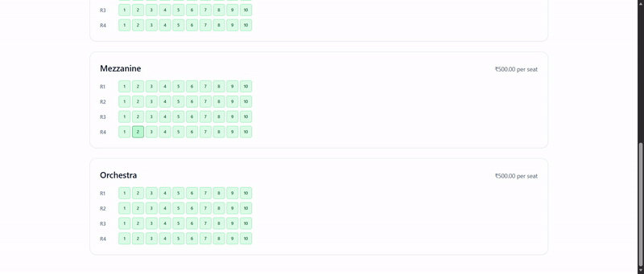

# SeatSync

SeatSync is a full-stack event-booking platform whose core guarantee is that no
seat is ever sold twice, even under concurrent checkout load. This repository is
a pnpm monorepo with an Express + TypeScript API (`apps/api`), a Next.js +
TypeScript web app (`apps/web`) and shared zod schemas (`packages/shared`),
backed by PostgreSQL 16 and Redis 7 via Docker Compose.

The live link, public demo logins and a recording of the seat map are in
[Demo](#demo); [How it works](#how-it-works) explains the architecture and the
double-booking rules, [Deployment](#deployment) covers production, and
[Running locally](#running-locally) gets the stack onto your machine.

## Demo

- **Live demo:** https://seatsync-teal.vercel.app
- **API:** https://seatsync-yaa6.onrender.com ([health](https://seatsync-yaa6.onrender.com/health), [Swagger UI](https://seatsync-yaa6.onrender.com/docs))

Demo logins (public throwaway accounts):

| Role | Email | Password |
| --- | --- | --- |
| Organizer | `demo-organizer@seatsync.demo` | `DemoOrganizer!2026` |
| Attendee | `demo-attendee@seatsync.demo` | `DemoAttendee!2026` |

These accounts and the **SeatSync Live Demo** event are created by
`pnpm --filter api seed:demo`, which runs idempotently in `deploy.yml` after
every deploy: the same two logins keep working and the demo event is reused
rather than duplicated. The passwords are public by design; never reuse them
anywhere else.



_Two browser sessions against the production deployment: one attendee holds a
seat the other has selected — the map recolors live and the "Seat just taken"
toast appears. Recorded against https://seatsync-teal.vercel.app._

The organizer owns the published **SeatSync Live Demo** event (4 sections × 4
rows × 10 seats = 160 seats, priced at 50,000 paise (₹500) each). `seed:demo` is
idempotent: it reuses the accounts and event and republishes the event if
needed, while leaving existing seats untouched.

## How it works

### Overview

SeatSync is a full-stack event-booking platform. Organizers create an event and
its seat map; attendees browse published events, hold up to
`MAX_SEATS_PER_HOLD` seats for `HOLD_TTL_SECONDS`, pay through a checkout link,
and watch the seat map update live in every open browser.

The core guarantee is **zero double-booking**: however many people race for the
same seat, at most one can ever confirm it. PostgreSQL decides every hold,
confirmation, release and refund; Redis only relays live updates and enforces a
per-user rate limit. Losing Redis pauses live updates and rate limiting — it can
never create a second sale.

### Architecture

```text
Browser
  │
  │  HTTPS  /api/*   (same-origin to Vercel; Next rewrites server-side)
  ▼
Vercel · Next.js web (apps/web)
  │
  │  HTTPS  proxied REST
  ▼
Render · Express API + ws (apps/api)  ◀──── WSS /ws ──── Browser (direct; rewrites
  │                                                        cannot proxy Upgrade)
  ├── SQL ─────────▶ Neon PostgreSQL 16   ← source of truth: seats, bookings,
  │                     row locks, conditional UPDATEs, partial unique indexes
  │
  ├── pub/sub ─────▶ Upstash Redis (rediss://)  ← live fan-out + rate limiting;
  │                     never correctness
  │
  └── HTTPS ───────▶ Razorpay test-mode checkout + webhooks (payment links, refunds)

Inside the API process: expireHolds sweeper (every SWEEPER_INTERVAL_SECONDS)
and retryRefunds job (same interval).
```

REST goes through the Vercel rewrite so the browser only needs the web origin.
The WebSocket connects straight to the API host: a Next.js rewrite is HTTP-only
and cannot carry an `Upgrade`, so the web build is given `NEXT_PUBLIC_WS_URL`
(`wss://<render-api>/ws`). Both web values are build-time constants, which is
why the deployment order is API first, web second.

### How double-booking is prevented

Every rule below is enforced by PostgreSQL, not by an application check and
never by Redis.

**Rule 1 — a hold is lock-then-update, all or nothing.** One transaction locks
the requested seats in deterministic ID order, then runs the conditional
UPDATE. A concurrent request waits on the row lock, re-evaluates the WHERE
clause and gets zero rows; if fewer seats come back than requested, the whole
transaction rolls back with `409 SEATS_UNAVAILABLE`.

```sql
SELECT id FROM seats ... ORDER BY id FOR UPDATE;
UPDATE seats SET status = 'HELD', hold_id = $1, held_until = now() + ...
 WHERE id = ANY($2) AND (status = 'AVAILABLE' OR (status = 'HELD' AND held_until < now()));
```

**Rule 2 — confirming a booking is a one-way, all-or-nothing transition.** The
webhook locks the booking `FOR UPDATE` and proceeds only while it is `PENDING`.
It pre-locks the hold's seats, then either marks all of them `BOOKED` and the
booking `CONFIRMED`, or releases what is left and marks the booking `FAILED` for
the refund job. A partial success is impossible.

```sql
SELECT ... FROM bookings WHERE id = $1 AND hold_id = $2 FOR UPDATE;
UPDATE seats SET status = 'BOOKED' WHERE hold_id = $2 AND status = 'HELD'; -- must return the expected count
```

**Rule 3 — a partial unique index is the last line of defense.** Even an
application bug cannot confirm two bookings for the same seat. The index is
scoped to `CONFIRMED`, so an abandoned `PENDING` checkout never blocks a new
buyer.

```sql
CREATE UNIQUE INDEX one_confirmed_booking_per_seat
  ON booking_seats (seat_id) WHERE status = 'CONFIRMED';
```

**Rule 4 — every webhook is processed once, in the same transaction as the
booking.** Verify the signature, insert the provider event id with
`ON CONFLICT DO NOTHING`, then confirm. A replay returns `200` without touching
seats; a mid-transaction failure rolls the dedupe row back, so the provider's
next retry is processed properly.

```sql
INSERT INTO processed_webhooks (event_id, provider) VALUES ($1, $2) ON CONFLICT DO NOTHING;
```

**Rule 5 — publish live updates only after COMMIT.** Clients never see a seat
change that later rolled back. If Redis is down the publish is dropped (and
logged), so a Redis outage can pause live updates but cannot fail a booking.

```text
COMMIT; then emit seatEvents -> Redis PSUBSCRIBE seats:* -> WebSocket rooms
```

**Rule 6 — store money as integer paise.** No floats and no rounding drift:
`seats.price_paise` and `bookings.amount_paise` are integers, and every amount
in the API and provider payloads is paise.

```sql
amount_paise integer NOT NULL CHECK (amount_paise >= 0)
```

**Rule 7 — every seat change increments `seats.version` in the same UPDATE.**
Live frames carry the version, and the web client applies a frame only when its
version is strictly greater, so duplicate or out-of-order messages cannot
regress the seat map.

```sql
UPDATE seats SET status = $2, version = version + 1 WHERE id = $1 RETURNING version;
```

**Why not Redis locks?** A Redis lock would add a second source of truth that
can expire, partition or disappear, while the database transaction already
serializes the conflicting writes. Redis is used only for pub/sub fan-out, the
per-user rate limit and caching; if it is unavailable, the API keeps taking
holds (rate limiting fails open) and live updates resume when it returns.

### Results

Measured on the Sprint 5 load host: AMD Ryzen 5 5600H (6 cores / 12 threads,
15.4 GiB visible RAM), Windows 11 Pro for Workstations, API + Postgres + Redis
in Docker Desktop containers, k6 v2.4.0 in a container on the same host. The API
ran with `PAYMENT_PROVIDER=fake` and `DB_POOL_SIZE=20`.

| Metric | Result |
| --- | --- |
| Oversells | **0** — no seat with more than one `CONFIRMED` `booking_seats` row; `load/invariants.sql` returned zero rows after all 6 scenario runs |
| Concurrency | **200 VUs**, one hold request each (200 users, 200 `Idempotency-Key`s, all racing the same 50 seats): 7×`201` + 193×`409` baseline, 6×`201` + 194×`409` re-run, **zero 5xx or other statuses** |
| p95 `POST /events/:id/holds` | **883.73 ms** baseline / **404.68 ms** re-run, against a pinned threshold of **p(95) < 2000 ms** |
| Throughput | **182.52 req/s** flash-sale (316.38 on the re-run), **30.05 req/s** mixed over 90 s, **480.54–497.41** webhook deliveries/s (516.58–534.72 total req/s) |
| Live update latency | **~37–80 ms** (in-suite 78–80 ms; real tabs across two replicas ≤37 ms, tab B flipping before tab A's own recolor) |
| Test coverage (API) | **87.44 % statements** / 87.43 % lines / 64.22 % branches / 88.64 % functions |
| Mixed / storm p95 | 22.17 ms mixed (threshold 50 ms, zero 429s); 77.03 ms webhook storm (threshold 200 ms) |

The p95 ceilings are ~2.3–2.6× the measured baselines and are pinned to this
development host: they catch regressions on the same machine, not a universal
latency SLO. Full narratives are in [docs/sprints.md](docs/sprints.md) and the
Metrics log in `docs/SeatSync_design.md`.

### Resume highlights

- **Zero oversells under a 200-VU flash sale.** Seat holds are PostgreSQL
  conditional `UPDATE`s over row-locked seats with a TTL sweeper, backed by a
  partial unique index; Redis is used only for pub/sub fan-out, rate limiting
  and caching, never for correctness. 200 virtual users raced for the same 50
  seats: 7×`201` + 193×`409` (6 + 194 on the re-run), zero 5xx, and the
  `load/invariants.sql` checks returned **0 rows** after all six load runs.
- **Measured p95 and throughput.** `POST /events/:id/holds` p95 was
  **883.73 ms** on the baseline 200-VU run and **404.68 ms** after query and
  index tuning, at **182–316 req/s** on one API container; a duplicate/late
  webhook storm sustained **~480–497 deliveries/s** with **zero
  double-confirms**.
- **Live seat map at ≤37 ms across replicas.** WebSocket fan-out over Redis
  pub/sub — published only after `COMMIT`, with per-seat version filtering —
  reached a second real browser tab in **≤37 ms** across two API replicas.
- **33 test suites / 144 tests, 87.4 % statement coverage** (Jest + Supertest
  against real PostgreSQL and Redis), plus a k6 load suite, a production smoke
  script and a GitHub Actions pipeline whose `deploy` job `needs: ci` and runs
  release migrations before both deploys.
- **Measurement-driven indexing.** Six query-serving indexes, three added after
  `EXPLAIN (ANALYZE, BUFFERS)` plans: the webhook shortfall release went from a
  45,050-row sequential scan (**7.48 ms**) to a 2-row index scan (**0.16 ms**).

## Deployment

Sprints 0–5 built the system (auth, seats and holds, payments and refunds,
real-time updates, load hardening); Sprint 6 deploys it:

| Component | Platform | Notes |
| --- | --- | --- |
| API + WebSocket | Render Web Service | Docker, repository-root build context, `apps/api/Dockerfile`, health check `/health`; long-lived sockets required, so no serverless API |
| Web | Vercel | Next.js project rooted at `apps/web`; REST proxied to the API, WebSocket direct |
| Database | Neon PostgreSQL 16 | Pooled URL at runtime, direct/unpooled URL for migrations (`node-pg-migrate` needs session advisory locks) |
| Redis | Upstash | `rediss://` TLS URL; pub/sub fan-out, rate limiting, cache — never correctness |
| Payments | Razorpay test mode | Payment links + webhook at `/webhooks/razorpay`; no real money |
| CI/CD | GitHub Actions | `ci.yml` on PRs and non-`main` branches; `deploy.yml` on `main` with an embedded `ci` gate |

Production shape and the exact checklist used for the public demo:

### Render service

Create a **Web Service** from this repository:

- Runtime **Docker**, build context **repository root**, Dockerfile
  **`apps/api/Dockerfile`**.
- Health check **`/health`**.
- Render injects `PORT`; `server.ts` binds `Number(process.env.PORT) || 4000`.
- Keep **Auto-Deploy off**. `deploy.yml` runs release migrations first and then
  calls the deploy hook, so the new image never starts against an old schema.

Runtime environment variables:

| Variable | Value |
| --- | --- |
| `DATABASE_URL` | Neon **pooled** connection string |
| `DB_POOL_SIZE` | `20` (tune down if the pooler imposes a lower connection limit) |
| `REDIS_URL` | Upstash `rediss://` connection string |
| `JWT_SECRET` | Fresh production secret (never reused from local `.env`) |
| `PAYMENT_WEBHOOK_SECRET` | Secret configured on the Razorpay webhook |
| `PAYMENT_PROVIDER` | `razorpay` (test-mode keys only) |
| `RAZORPAY_KEY_ID` | Razorpay test-mode key id |
| `RAZORPAY_KEY_SECRET` | Razorpay test-mode key secret |
| `CORS_ORIGINS` | `https://<vercel-domain>` — set after the first web deploy; comma-separated allowlist, never `*` |
| `ACCESS_TOKEN_TTL_SECONDS`, `REFRESH_TOKEN_TTL_SECONDS`, `HOLD_TTL_SECONDS`, `SWEEPER_INTERVAL_SECONDS`, `MAX_SEATS_PER_HOLD`, `HOLDS_RATE_LIMIT_PER_MINUTE`, `RETENTION_DAYS`, `LIVE_UPDATE_MAX_MS` | Optional; the defaults in the Config table apply |

### Neon, Upstash and Vercel

- **Neon:** create a project and copy **two** URLs — the pooled URL for Render's
  `DATABASE_URL`, and the direct/unpooled URL for the `PROD_DATABASE_URL`
  GitHub secret. Migrations use the direct URL.
- **Upstash:** create a Redis database and copy its TLS `rediss://` URL. Put it
  on Render as `REDIS_URL` and in GitHub as `PROD_REDIS_URL`.
- **Vercel:** create the project **once** in the dashboard — **Add New →
  Project**, import the `seatsync` repository, set **Root Directory** to
  `apps/web` (the framework is auto-detected as Next.js; the default build
  settings work with the pnpm workspace). Then add an account token as
  `VERCEL_TOKEN` and copy **Org ID** and **Project ID** from **Settings →
  General** into the GitHub secrets `VERCEL_ORG_ID` and `VERCEL_PROJECT_ID`.
  The workflow runs `vercel deploy --prod --yes` from the repository root and
  lets the project's Root Directory select `apps/web`; the CLI links the fresh
  checkout to the existing project from those env values (no
  `.vercel/project.json` is committed) and supplies `API_PROXY_TARGET` and
  `NEXT_PUBLIC_WS_URL` as build environment values, so they do not need to be
  configured in the dashboard. Both are derived from the single
  `RENDER_API_URL` secret.
- **Razorpay:** in test mode, add the webhook
  `https://<render-api>/webhooks/razorpay` with the events
  `payment_link.paid`, `payment_link.expired` and `payment_link.cancelled`.
  Its secret must equal `PAYMENT_WEBHOOK_SECRET` on Render and in GitHub.

### GitHub repository secrets

Settings → Secrets and variables → Actions:

| Secret | Consumed by | Value |
| --- | --- | --- |
| `RENDER_API_URL` | deploy guard, web build, health wait, smoke | `https://<service>.onrender.com` (no trailing slash needed) |
| `RENDER_DEPLOY_HOOK_URL` | Render deploy step | The deploy hook Render generates for the service |
| `PROD_DATABASE_URL` | release migrations, `seed:demo` | Neon **direct/unpooled** URL |
| `PROD_REDIS_URL` | `seed:demo` config validation | Upstash `rediss://` URL (same value as Render's `REDIS_URL`) |
| `PROD_JWT_SECRET` | `seed:demo` config validation | Same value as Render's `JWT_SECRET` |
| `PAYMENT_WEBHOOK_SECRET` | `seed:demo` config validation | Same value as Render's `PAYMENT_WEBHOOK_SECRET` |
| `VERCEL_TOKEN` | Vercel CLI deploy | Vercel account token |
| `VERCEL_ORG_ID` | Vercel CLI deploy (project linking) | **Settings → General → Org ID** of the Vercel team/account |
| `VERCEL_PROJECT_ID` | Vercel CLI deploy (project linking) | **Settings → General → Project ID** of the `seatsync` Vercel project |
| `RAZORPAY_KEY_ID` | Not read by `deploy.yml` | Keep a copy with the other production secrets; set the same value on Render |
| `RAZORPAY_KEY_SECRET` | Not read by `deploy.yml` | Keep a copy with the other production secrets; set the same value on Render |

`seed:demo` only needs `REDIS_URL`, `JWT_SECRET` and `PAYMENT_WEBHOOK_SECRET`
to satisfy the fail-fast config loader; it sets `PAYMENT_PROVIDER=fake` because
it writes accounts, an event and seats, never payments.

### Bootstrap sequence

1. Create the Neon project and the Upstash Redis database; copy the pooled and
   direct Neon URLs and the Upstash `rediss://` URL.
2. Create the Render web service with the settings and environment variables
   above. Copy its public URL and create a deploy hook.
3. Create the Vercel project once via the dashboard (**Add New → Project**,
   import the `seatsync` repository, Root Directory `apps/web`) and copy its
   **Org ID** and **Project ID** from **Settings → General**.
4. Add all eleven GitHub secrets from the table above.
5. Push or merge to `main`. `deploy.yml` runs its `ci` job, applies release
   migrations with `PROD_DATABASE_URL`, POSTs the Render deploy hook, deploys
   `apps/web` to Vercel production, waits for `/health`, runs `seed:demo`, and
   finishes with `scripts/smoke.sh` against the deployed API.
6. Copy the Vercel production domain into Render's `CORS_ORIGINS`
   (`https://<vercel-domain>`), save (Render restarts), and set the Razorpay
   checkout webhook to `https://<render-api>/webhooks/razorpay`.
7. Re-run the smoke test from your machine (below), then open the live site and
   hold a seat as the demo attendee.

The deploy job declares `needs: ci` **inside `deploy.yml`**. GitHub Actions
cannot reference a job in another workflow, so `deploy.yml` embeds the same
Postgres + Redis + lint/typecheck/migrate/test/coverage gate as `ci.yml` under
the job id `ci`. A failing test skips `deploy` (spec acceptance §396);
`ci.yml` itself ignores pushes to `main` to avoid running the suite twice.

### Smoke test runbook

`scripts/smoke.sh` checks `/health`, logs in as the demo attendee, finds the
published demo event, picks an available seat, holds it, requests a checkout
URL, releases the hold and verifies the seat is `AVAILABLE` again. It never
follows or pays the checkout URL.

From the repository root on Windows:

```bash
wsl bash scripts/smoke.sh https://<render-api>
```

or from Git Bash:

```bash
bash scripts/smoke.sh https://<render-api>
```

Against the local stack, use `bash scripts/smoke.sh http://localhost:4000`.

Reviewer notes:

- **Compact-JSON assumption:** the script extracts fields with `grep`/`sed`
  against the API's default compact JSON. A proxy or middleware that
  pretty-prints or reorders the response body can break extraction.
- **Demo event must have an available seat:** the script needs one `AVAILABLE`
  seat in the `SeatSync Live Demo` event. It releases the seat it holds, so
  repeated runs are fine, but if all 160 demo seats have been held or booked,
  recreate/reset the demo event first — `seed:demo` deliberately never resets
  existing seats, so live holds and bookings stay intact.
- **Razorpay note:** with `PAYMENT_PROVIDER=razorpay` the checkout endpoint
  returns a real `rzp.io` payment-link URL. Smoke asserts the URL is non-empty
  and never follows it, so no payment happens.

### CI

`.github/workflows/ci.yml` runs on pull requests and on pushes to every branch except `main`. A single Ubuntu job uses Node.js 22 and pnpm 10.8.1, with `postgres:16` and `redis:7` service containers, then runs `pnpm install --frozen-lockfile`, `pnpm lint`, `pnpm typecheck`, `pnpm --filter api migrate up`, `pnpm --filter api migrate down`, `pnpm --filter api migrate up` and `pnpm test`. It then runs `pnpm --filter api test --coverage` and uploads `apps/api/coverage/` as the `api-coverage` artifact (14-day retention); coverage is report-only.

`.github/workflows/deploy.yml` runs on pushes to `main` only. Its `ci` job is the same gate (same services, env, step order, coverage artifact), and the `deploy` job declares `needs: ci`: any failure skips release migrations, the Render deploy hook, the Vercel deploy, the demo seed and the live smoke test. The deploy job applies release migrations with the Neon direct URL, triggers the Render deploy hook, builds and deploys `apps/web` to Vercel production with `API_PROXY_TARGET` and `NEXT_PUBLIC_WS_URL`, waits for `/health`, re-runs the idempotent `seed:demo`, and finishes with `scripts/smoke.sh` against the deployed API. `ci.yml` ignores `main` so the suite does not run twice for one commit. CI uses the standard Postgres port 5432 because the hosted runner is clean; local development uses 5434 (see [Windows notes](#windows-notes)). Both workflows and their run history are at https://github.com/Bucke200/seatsync/actions.

## Running locally

### Quick start

Prerequisites, setup and the full compose stack are in
[Prerequisites](#prerequisites), [Setup](#setup) and
[Full stack](#full-stack) below. The short version:

```bash
cp .env.example .env              # PowerShell: Copy-Item .env.example .env
pnpm install
docker compose up -d db redis
pnpm --filter api migrate up
pnpm --filter api seed:demo
pnpm --filter api start           # API on http://localhost:4000 (terminal 1)
pnpm --filter web dev             # web on http://localhost:3000 (terminal 2)
```

Then open http://localhost:3000, sign in with the
[demo accounts](#demo), hold a seat, release it, and run the smoke test:

```bash
bash scripts/smoke.sh http://localhost:4000
```

On Windows, run `bash scripts/smoke.sh` from Git Bash or WSL
(`wsl bash scripts/smoke.sh ...`); PowerShell cannot execute the shell script
directly. The full stack (`docker compose up -d`) also builds and runs the API
and web containers; see [Full stack](#full-stack).

### Prerequisites

- **Node.js 22** (`node --version`)
- **pnpm 10.8.1** via Corepack — run `corepack enable` once; the root `package.json` pins `packageManager: pnpm@10.8.1`, so the pnpm shim installs and uses that exact version.
- **Docker Desktop** with Compose v2 (`docker compose version`)

### Setup

From the repository root, in PowerShell:

```powershell
Copy-Item .env.example .env
pnpm install
docker compose up -d db redis
pnpm --filter api migrate up
```

### Standard commands

From the repository root:

```bash
pnpm install
docker compose up -d db redis
pnpm --filter api migrate up
pnpm lint && pnpm typecheck && pnpm test
pnpm --filter api test -- <file-pattern>
```

Lines joined with `&&` (including the quality gate below) need PowerShell 7+, `cmd`, or Git Bash; on Windows PowerShell 5.1, run each command on its own line.

For example, `pnpm --filter api test -- health` runs only `apps/api/test/health.test.ts`.

### Full stack

```bash
docker compose up -d
```

This builds and starts `db`, `redis`, `api` (http://localhost:4000) and `web` (http://localhost:3000). The API container waits for healthy dependencies, runs migrations on boot, then starts the server. Stop everything with `docker compose down`.

### Seeding demo data locally

`pnpm --filter api seed:demo` creates the two [demo accounts](#demo) and the published **SeatSync Live Demo** event (4 sections × 4 rows × 10 seats = 160 seats, priced at 50,000 paise (₹500) each) in the local database. It is idempotent — it reuses the accounts and event, republishes the event if needed, and leaves existing seats untouched — and it writes accounts, events and seats only, never payments.

```bash
pnpm --filter api seed:demo
```

### Running the tests and load tests

The quality gate runs the Jest + Supertest integration suite against the real
compose Postgres (see [Standard commands](#standard-commands)):

```bash
pnpm lint
pnpm typecheck
pnpm test
```

That is **33 suites / 144 tests**, including the 200-way concurrent hold race,
webhook replay and late-payment refund suites, WebSocket protocol tests and the
Redis-down proof. Coverage is report-only and uploaded by CI.

The k6 load suite, its seeding and the PowerShell runbook are below. Each
scenario needs a fresh `pnpm --filter api seed:load` because seeded JWTs expire
after 15 minutes:

```bash
pnpm --filter api seed:load
k6 run load/flash-sale.js     # 200 VUs racing for the same 50 seats
k6 run load/mixed.js          # 20 VUs for 90 s: browsing + holds/releases
k6 run load/webhook-storm.js  # 20 VUs / 200 duplicate & late deliveries
```

After each run, `load/invariants.sql` must return zero rows.

#### Load-test runbook (Sprint 5)

Run the load tests on Windows PowerShell 5.1 (one line at a time). The dev
`.env` uses `PAYMENT_PROVIDER=razorpay`, which rejects fake-provider webhooks, so
the normal `api` container is stopped and a temporary one is started on the same
port from the compose-built image:

```powershell
docker compose stop api
pnpm --filter api migrate up
docker run -d --rm --name seatsync-load-api --network seatsync_default -p 4000:4000 `
  --env-file .env `
  -e DATABASE_URL=postgres://seatsync:seatsync@db:5432/seatsync `
  -e REDIS_URL=redis://redis:6379 `
  -e PAYMENT_PROVIDER=fake `
  -e PAYMENT_WEBHOOK_SECRET=load-secret `
  -e DB_POOL_SIZE=20 `
  seatsync-api
pnpm --filter api seed:load

docker run --rm -v "${PWD}/load:/load" -i `
  -e API_BASE_URL=http://host.docker.internal:4000 `
  grafana/k6 run /load/flash-sale.js
Get-Content load\invariants.sql -Raw | docker exec -i seatsync-db-1 psql -U seatsync -d seatsync -f -

docker run --rm -v "${PWD}/load:/load" -i `
  -e API_BASE_URL=http://host.docker.internal:4000 `
  grafana/k6 run /load/mixed.js
Get-Content load\invariants.sql -Raw | docker exec -i seatsync-db-1 psql -U seatsync -d seatsync -f -

docker run --rm -v "${PWD}/load:/load" -i `
  -e API_BASE_URL=http://host.docker.internal:4000 `
  -e PAYMENT_WEBHOOK_SECRET=load-secret `
  grafana/k6 run /load/webhook-storm.js
Get-Content load\invariants.sql -Raw | docker exec -i seatsync-db-1 psql -U seatsync -d seatsync -f -

docker stop seatsync-load-api
docker compose start api
```

`load/users.json` is gitignored. The seeded JWTs expire after `ACCESS_TOKEN_TTL_SECONDS` (15 minutes), so run `seed:load` immediately before **each** scenario — `webhook-storm` also consumes seats 0–4 in its setup, and the hold scenarios leave seats held — and re-seed again before the next one.

The measured numbers are in [Results](#results); the full Sprint 5 narrative,
notes and per-scenario table are in
[docs/sprints.md](docs/sprints.md#sprint-5--load-testing-and-hardening).

### Multi-instance scale stack (Sprint 4)

`docker-compose.scale.yml` verifies that the realtime seat map works across more than one API process: two `api` replicas share one Postgres and one Redis, sit behind `nginx` (which round-robins Docker DNS A-records and forwards WebSocket `Upgrade` headers), and a client on one replica receives changes committed through another replica via Redis pub/sub. It is a **standalone** compose file, not an override: the `seatsync-scale` project has its own database, Redis and named volume, so it can run beside the normal development stack without touching it.

Host ports are deliberately shifted so both stacks can run at once (`SCALE_DB_PORT`, `SCALE_REDIS_PORT`, `NGINX_PORT`, `WEB_PORT` override them):

| Service | Scale stack | Normal stack |
| --- | --- | --- |
| API HTTP + WS | `http://localhost:4010` (nginx) | `http://localhost:4000` (api) |
| Web | `http://localhost:3010` | `http://localhost:3000` |
| Postgres | `localhost:5435` | `localhost:5434` |
| Redis | `localhost:6380` | `localhost:6379` |

Migrations run **once per stack start**: the one-shot `migrate` service applies them and exits, and both replicas wait for `service_completed_successfully`. The replica command is `node --import tsx src/server.ts`, deliberately skipping migrate-on-boot so two processes can never race `node-pg-migrate`. To apply migrations without starting the stack:

```bash
docker compose -f docker-compose.scale.yml -p seatsync-scale run --rm migrate
```

Boot it (the migrate step above runs automatically; `--scale api=2` starts the two replicas):

```bash
docker compose -f docker-compose.scale.yml -p seatsync-scale up -d --build --scale api=2
```

Verify it:

```bash
curl.exe -s -o NUL -w "%{http_code}" http://localhost:4010/health
# 200 — the access log records upstream=<replica-ip>:4000; repeat the request
# and the two upstream addresses prove nginx is balancing both replicas
docker compose -f docker-compose.scale.yml -p seatsync-scale ps
docker compose -f docker-compose.scale.yml -p seatsync-scale logs nginx
```

A WebSocket client connects directly to `ws://localhost:4010/ws` (nginx proxies `Upgrade`/`Connection` with a one-hour idle read timeout); REST goes through the web app's `/api/*` proxy or straight to `http://localhost:4010`. Because the browser cannot use a compose hostname, the WS URL names the host-visible nginx port, not `api:4000`. The scale stack's web image is built with the default `ws://localhost:4000/ws`; to drive the seat map through nginx from a browser, run the web app with `NEXT_PUBLIC_WS_URL=ws://localhost:4010/ws` (inlined at build time).

Tear it down completely, including only the scale project's own volume:

```bash
docker compose -f docker-compose.scale.yml -p seatsync-scale down -v
docker volume ls   # seatsync_pgdata (the normal stack's volume) is still there
```

### Acceptance checks

Health endpoint (database and Redis both up):

```bash
curl.exe -s localhost:4000/health
# {"db":"ok","redis":"ok"}
```

Degraded health endpoint (Redis stopped, Postgres still up):

```bash
docker compose stop redis
curl.exe -i localhost:4000/health
# HTTP/1.1 503 Service Unavailable
# {"db":"ok","redis":"error"}
# X-Request-Id: <uuid>
docker compose start redis
```

Migrations in both directions:

```bash
pnpm --filter api migrate up
pnpm --filter api migrate down
pnpm --filter api migrate up
```

Quality gate (lint, strict typecheck and the Jest + Supertest integration suite, which runs against the compose Postgres):

```bash
pnpm lint && pnpm typecheck && pnpm test
```

### Windows notes

- Create the local env file with `Copy-Item .env.example .env`.
- Use `curl.exe`, not `curl`: in Windows PowerShell, `curl` is an alias for `Invoke-WebRequest` and does not accept these flags.
- The compose `db` service is published on host port **5434**, not 5432, so it cannot clash with a local PostgreSQL already on 5432 (or 5433). The `POSTGRES_*` values and `DATABASE_URL` in `.env.example` and `.env` must stay in sync with that port; the API container itself talks to `db:5432` internally.
- Windows PowerShell 5.1 does not support `&&`; run the commands separately or use PowerShell 7+.

## Sprints

Sprints 0–5 built the system and Sprint 6 deployed it. The full per-sprint
engineering notes are in [`docs/sprints.md`](docs/sprints.md); one line each:

- **[Sprint 0 — Foundation](docs/sprints.md#sprint-0--foundation):** pnpm monorepo, strict TypeScript, a fail-fast typed config loader, the `users` migration, `/health` with request-ID logging, integration tests and CI.
- **[Sprint 1 — Auth, roles and events](docs/sprints.md#sprint-1--auth-roles-and-events):** argon2 passwords, JWT access tokens and refresh cookies, organizer-owned events and seats, OpenAPI/Swagger, and the first web flows.
- **[Sprint 2 — Seat holds](docs/sprints.md#sprint-2--seat-holds):** the lock-then-update hold path, idempotency keys, the TTL sweeper, expired-hold reads and the 200-way race proof.
- **[Sprint 3 — Payments and bookings](docs/sprints.md#sprint-3--payments-and-bookings):** checkout, signed webhook dedupe, confirm-or-release, automatic refunds and booking reads.
- **[Sprint 4 — Real-time seat map](docs/sprints.md#sprint-4--real-time-seat-map):** `WS /ws`, Redis pub/sub fan-out only after `COMMIT`, per-seat version filtering, reconnect, and the two-replica scale stack.
- **[Sprint 5 — Load testing and hardening](docs/sprints.md#sprint-5--load-testing-and-hardening):** per-user hold rate limiting, security middleware, three measurement-driven indexes and the k6 flash-sale/mixed/webhook-storm suite.
- **[Sprint 6 — Deploy and ship](docs/sprints.md#sprint-6--deploy-and-ship):** Render + Vercel + Neon + Upstash, `deploy.yml` with a `needs: ci` gate, the idempotent demo seed and the production smoke test.
